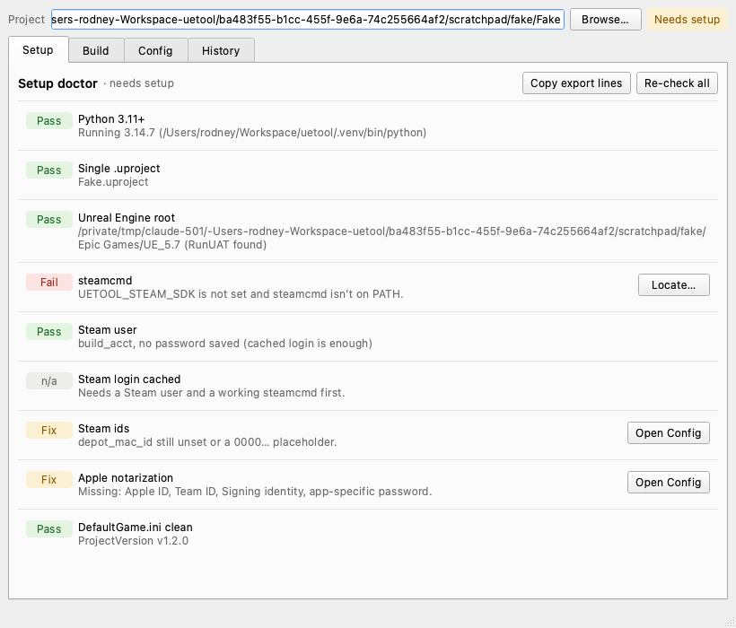
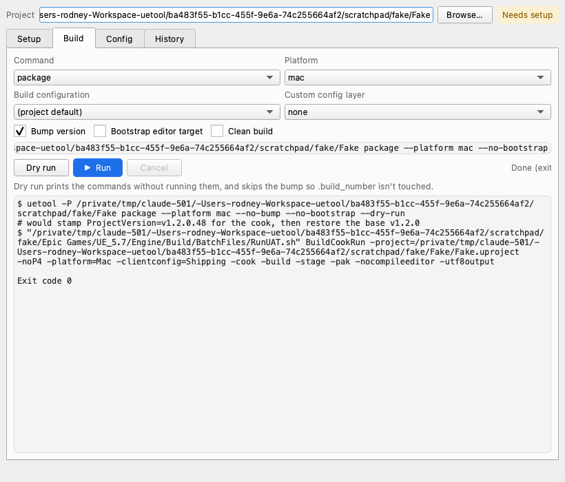
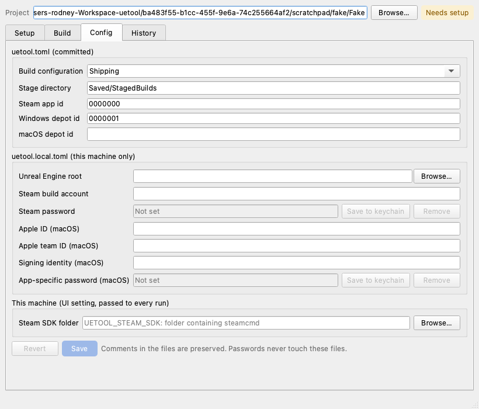
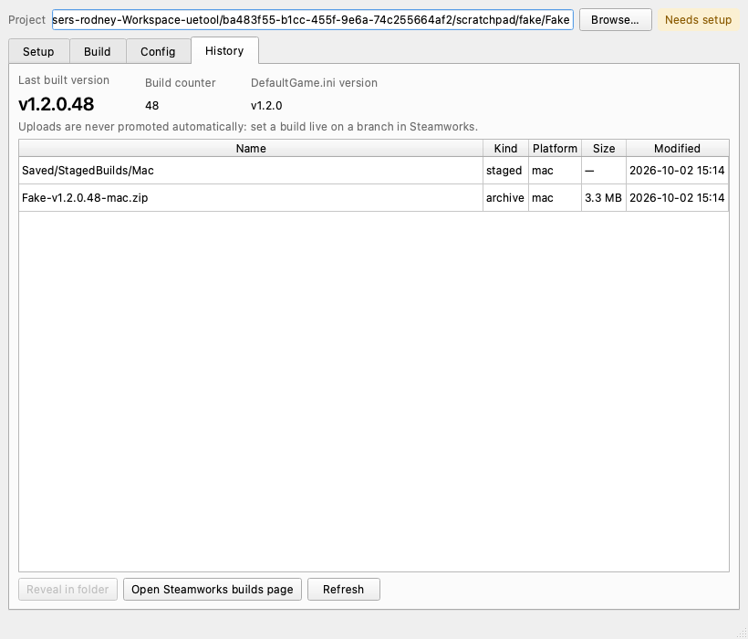

# Progress Report: UETool Control Panel

*A PySide6 front end for an Unreal Engine CI/CD tool. This is an approved substitution for the Maya tool, so "Maya result" below means the result in the Unreal build pipeline.*

Code: branch `pyside-ui`, https://github.com/DukeGDDI/uetool/tree/pyside-ui

## 1. Project and scope update

- **User:** a technical artist, designer or programmer on a small Unreal team with no dedicated build engineer.
- **Problem:** UETool is a CLI that packages and ships an Unreal project to Steam. Setup takes about nine manual steps per OS, and mistakes fail silently. Day-to-day use means remembering flag combinations, and dangerous ones such as `--clean` are only caught at runtime.
- **Advanced feature:** the **Setup Doctor**, a checklist that verifies the environment and offers a fix for each failing item.
- **Minimum viable result:** pick a project, see the Doctor checklist, edit the config, build any command from a form with a live preview, then run it with a streaming log and a safe Cancel.

**Changes since the proposal.**
- The UI runs the real CLI through `QProcess`, so the existing tool is untouched and can't drift from the UI. I chose this over refactoring the CLI because it's less work and less risky.
- Secrets live in the OS keychain and reach the CLI only as environment variables of the child process.
- The History tab is read-only. Presets and a build-stage tracker remain stretch goals.

## 2. What works now

**Working (implemented and verified):**
- **Setup tab:** the Doctor checks Python 3.11+, a single `.uproject`, the engine root, steamcmd, the cached Steam login, Steam ids, Apple fields and a stamped `DefaultGame.ini`. It offers fix actions and a "Copy export lines" button.
- **Build tab:** a form that builds the real command with a live preview, Dry run, Run, Cancel and a streaming log. The guardrails are `release` blocking a custom config layer, `notarize` allowed only on macOS, and a `--clean` warning.
- **Config tab:** edits `uetool.toml` and `uetool.local.toml` and keeps their comments. Placeholder ids are flagged.
- **History tab:** the current version and the archive list.
- **Runner:** streams output live and cancels gracefully, killing the process only after a grace period.
- **Verified on a real project (D6scend):** the UI generated the correct command, and a full `release` was built and deployed to Steam, consistent with running the CLI by hand. The Doctor also ran correctly against its existing `.toml` files.

**Not done or not verified:**
- **Fresh-project setup is untested.** I haven't taken a brand-new project from nothing to configured through the UI, because I have no Steam app id to test with. The Doctor is verified against fixture and D6scend files, but not against a user's first-ever setup.
- Cancel during a real cook, and Windows, are untested.
- `uetool gui` as a launcher, saved presets, and writing environment variables for the user are planned, not built.
- `ui/mockup.py` is the original mockup, kept for reference.

Screenshots (from `ui/screenshots/`):

## 3. What have I tested?

**Test A: real end-to-end release (D6scend).**
- Input: the D6scend project with its existing `uetool.toml` and `uetool.local.toml`.
- Action: choose `release` in the Build tab and run it.
- Expected: the preview shows the same command I'd type in the CLI, and the build packages and uploads to Steam.
- Actual: the command matched, and the build was packaged and deployed to Steam the same way the CLI does it.

**Test B: Doctor against pre-built config.**
- Action: run the Doctor on D6scend and on fixture projects with pre-built `.toml` files.
- Expected: each check reports the right state for its config.
- Actual: the checks reported correctly. The fixtures included placeholder Steam ids, which the Doctor flagged.

**Test C: dry-run behavior (a finding).**
- Input: a fixture project with `.build_number` = 5.
- Action: `uetool bump --dry-run`.
- Expected: the counter stays at 5.
- Actual: **the counter became 6.** `bump` isn't dry-run aware, and `package` and `release` bump the version even with `--dry-run`.
- What it revealed: a UI that offers "Dry run" would silently change a real project's version counter. The UI now skips the bump for dry runs, and the Build tab says so.

**Test D: invalid-combination guardrail.**
- Action: `release --platform mac --custom-config Arcware --dry-run`.
- Expected: the CLI refuses.
- Actual: it refused with exit code 1 and a message suggesting `package` plus `archive`. The UI blocks the combination before launch.

**Test E: automated suite.** `python -m pytest` gives **58 passed in 5.15 seconds**. It covers:
- Command building, including a check that the UI's flag table matches the real argparse parser.
- Config round trips.
- Every Doctor check.
- The runner, including cancel followed by file restore.

## 4. What is blocking me?

The main risk is that the first-run experience, which is the point of the Doctor, can't be fully tested. I have one real project with an existing Steam app, and I have no Steam app id to run a fresh setup against. So I can't show a new user going from an empty project to a working release.

What I've done instead: tested the Doctor against fixture projects with placeholder ids and missing fields, and against D6scend's complete configuration.

**Question:** for the demo, is it acceptable to show the fresh-setup flow with a fixture project and placeholder ids, with a real release shown only on D6scend, or should I find another way to show a first-time setup?

A smaller open risk is Cancel during a real cook. The CLI stamps `DefaultGame.ini` and restores it in a `finally` block. The automated tests cover cancel and restore with a stand-in process, but not a real cook, and Windows is untested.

## 5. What comes next

1. **Must work for the minimum result:** record a short screen recording of the D6scend workflow: Doctor, Build preview, run, History.
2. Demonstrate the fresh-project path on a fixture, showing the Doctor catching missing and placeholder values and the Config tab fixing them.
3. Test Cancel during a real build and confirm the ini is restored.
4. Fix whatever those runs reveal, and finish the write-up.
5. **Cut or postpone if time is short:** presets, the stage-progress tracker, one-click environment variable writing, the `uetool gui` launcher and Windows verification.
